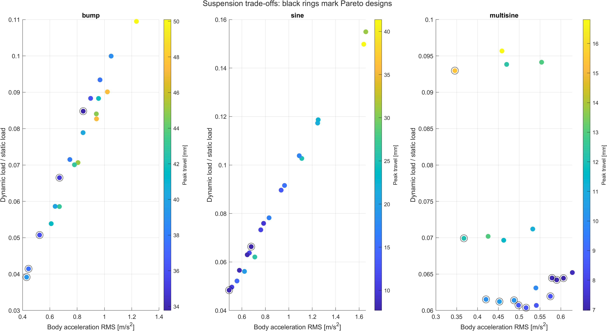
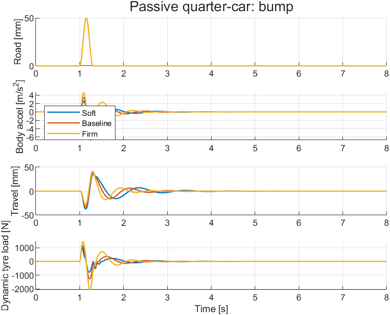
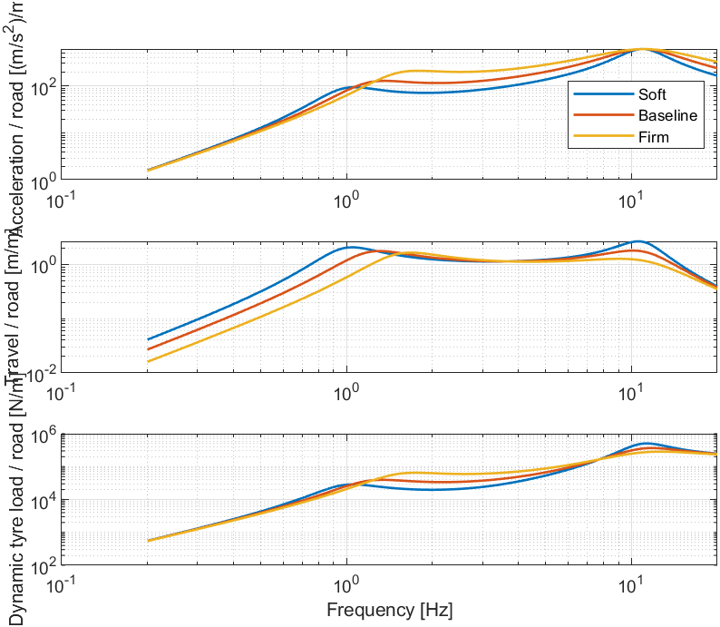

# Quarter-Car Suspension Modelling and Parametric Analysis

**Kushal Gayen | Mechanical Engineering, NIT Durgapur**

How much can a passive suspension improve ride comfort before the trade-off shows up in wheel-load variation or suspension movement? This project explores that question with a two-degree-of-freedom quarter-car model in MATLAB and Simulink.

The study compares **20 spring–damper combinations across three road inputs**, checks the model against basic physical principles, and selects a configuration using an explicit decision rule. All results below come from the saved MATLAB runs.

**[Read the report (PDF)](docs/Project_Report.pdf)** · **[Report on GitHub](docs/PROJECT_REPORT.md)** · **[Project motivation](docs/MOTIVATION.md)** · **[Reproduce the study](docs/REPRODUCIBILITY.md)**



*Each point is a tested design. Colour shows peak suspension travel. Black rings identify designs that are nondominated across all three metrics—not only the two plotted axes. Colour scales differ between road panels.*

## Main finding

The selected combination uses **12,000 N/m spring stiffness and 1,500 N s/m damping**, compared with the baseline of 18,000 N/m and 1,500 N s/m.

| Multisine metric | Baseline | Selected | Change |
|---|---:|---:|---:|
| Body acceleration RMS [m/s²] | 0.45269 | 0.42048 | 7.12% lower |
| Peak suspension travel [mm] | 10.490 | 10.104 | 3.68% lower |
| Dynamic tyre-load RMS [N] | 204.20 | 205.20 | 0.49% higher |

The decision rule was to minimise multisine acceleration RMS while keeping travel no greater than the baseline and tyre-load RMS within 5% of the baseline, subject to the assumed travel/contact screens. This is the best eligible point in the tested grid; it is not a universal suspension optimum.

## Why this project

A suspension has to support the body, absorb road disturbances and keep the wheel load reasonably consistent. Those goals do not always favour the same spring or damper. I chose a quarter-car model because it is small enough to trace every force, but still captures the interaction between body motion and wheel motion. The aim was to make an engineering decision from the results, rather than stop at a set of response plots.

This is an independent educational project. The parameters are illustrative and are not calibrated to a Tata Motors, Hyundai or other production vehicle.

## What is included

- A passive two-mass model, with road height as the input.
- MATLAB integration and an explicit force-balance Simulink model.
- Bump, sinusoidal and repeatable synthetic multisine inputs.
- A 60-case parameter sweep, frequency responses and three-objective Pareto screening.
- Saved CSV data, MATLAB workspaces, figures and the selected-design record.
- Seven physics/numerical checks and 21 MATLAB–Simulink signal comparisons, all passed.

## Run it

Tested in **MATLAB R2024a**. The MATLAB study uses base MATLAB. Building or running the `.slx` model also requires Simulink. No Simscape, Control System Toolbox or optimisation toolbox is required.

Clone or download this repository, open its root folder in MATLAB, and run:

```matlab
START_HERE                 % First baseline bump response
verify_project             % Seven physics and numerical checks
run_studies                % Comparisons, parameter sweep and plots
select_configuration       % Reproduce the documented design choice
build_simulink             % Open included model, or build it if absent
verify_simulink             % Compare seven signals on each road input
```

These commands regenerate files in `results/`. The committed outputs are already available for readers without MATLAB. If a figure opens behind the desktop, enter `shg`.

## Repository guide

| Location | What to look for |
|---|---|
| `START_HERE.m` | A first baseline run and plots |
| `qc_parameters.m` | Mass, spring, damper, tyre and time settings |
| `qc_matrices.m`, `qc_simulate.m` | State equations and integration |
| `qc_road.m`, `qc_metrics.m` | Input definitions and metric calculation |
| `run_studies.m` | Comparisons, sweep, Pareto flags and frequency response |
| `select_configuration.m` | Transparent, repeatable selection rule |
| `quarter_car_passive.slx` | Completed Simulink model |
| `build_simulink.m` | Script that generates the model from standard blocks |
| `verify_project.m`, `verify_simulink.m` | Verification routines |
| [`results/`](results/) | Actual MATLAB results, plots and verification tables |
| [`docs/`](docs/) | Report, motivation, methods and data dictionary |
| `independent_check.py`, `reference_results/` | Optional independent Python reference calculation |

## What the checks establish

The seven checks cover equilibrium, stability, energy and numerical convergence. The MATLAB–Simulink comparison checks seven signals for each of three roads. Its largest relative L2 error is **2.03 × 10⁻⁶**, below the acceptance limit of 10⁻³.

This establishes numerical consistency for the tested cases. It is not experimental validation. Acceleration RMS is unweighted, tyre-load fluctuation is a road-holding proxy, and the model omits pitch, roll, tyre lift-off, bump stops and nonlinear damper behaviour. The assumed ±60 mm dynamic travel screen is not a measured vehicle clearance.

## Figures



*The 50 mm smooth bump highlights the transient response. The configuration names refer to paired changes in spring stiffness and damping; the separate sweep isolates each parameter.*



*Continuous-model gains from road displacement over 0.2–20 Hz. These explain frequency sensitivity; they are not measured vehicle responses.*

## Reference

The force-balance structure follows the conventional quarter-car model described in [MathWorks: Robust Control of Active Suspension](https://www.mathworks.com/help/robust/gs/active-suspension-control-design.html), with actuator force set to zero. The present project studies passive parameter choices using its own stated assumptions.
