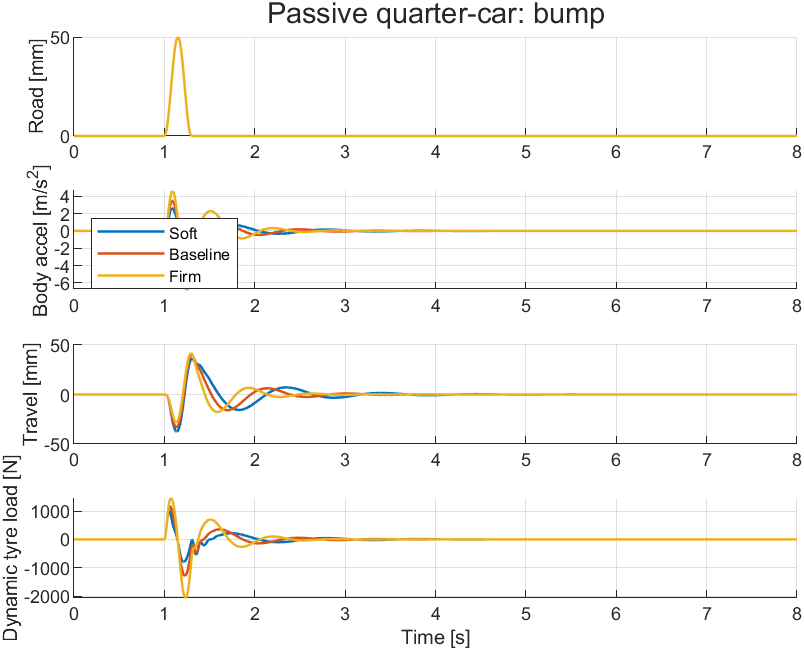
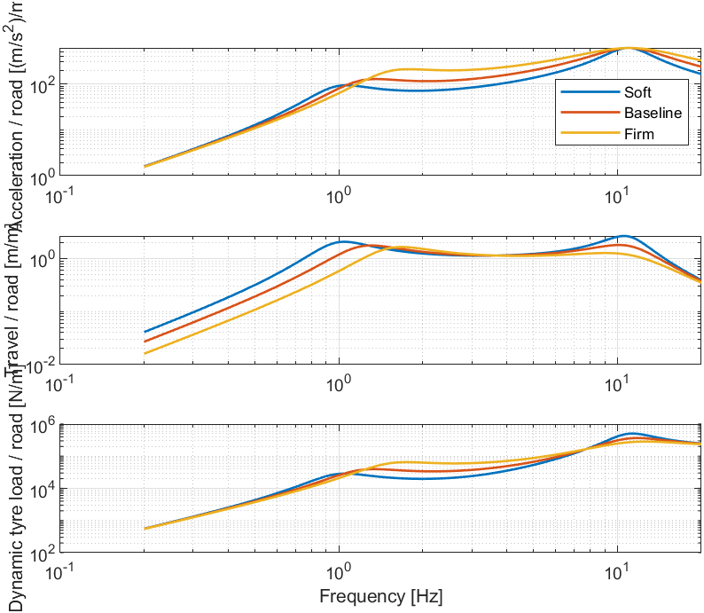
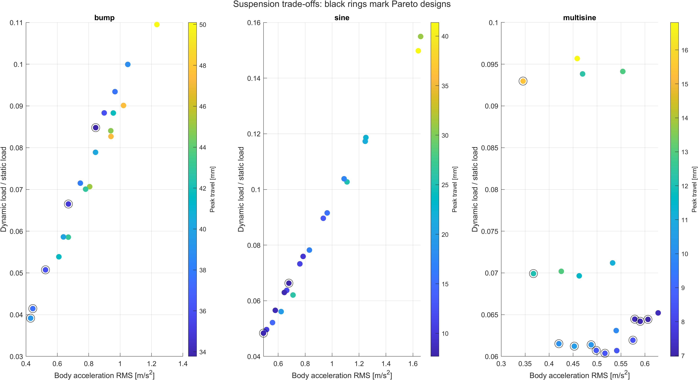

# Quarter-Car Suspension Modelling and Parametric Analysis

**Project report · Kushal Gayen · 1 November 2026**

## 01 / Motivation and scope

A suspension setting is a compromise between how the body responds, how far the suspension moves and how much the wheel load changes. This project examines that compromise with a passive quarter-car model and a finite parameter sweep.

The objective is to compare spring stiffness and damping configurations under a smooth bump, a sinusoidal road and a synthetic multisine road, then choose a configuration using a stated rule. The model represents one wheel assembly and its share of the body. It is an educational simulation, with illustrative parameters rather than manufacturer data.

The principal result is a selected stiffness of 12,000 N/m with damping of 1,500 N s/m. For the multisine input, compared with the baseline, acceleration RMS falls by 7.12%, peak travel falls by 3.68%, and dynamic tyre-load RMS rises by 0.49%. These percentages describe simulation outputs under the stated conditions; they are not measured improvements to a vehicle.

The engineering contribution is the complete process: equations, two implementations, physical checks, an independent parameter sweep, interpretable metrics and a reproducible decision. The project does not introduce a new suspension architecture.

## 02 / Physical model

The sprung mass ms represents the supported share of the body. The unsprung mass mu represents the wheel assembly. A linear spring ks and viscous damper cs act in parallel between them. A linear tyre spring kt connects the wheel to the prescribed road height r(t).

Upward displacement is positive. Body displacement zs and wheel displacement zu are measured from static loaded equilibrium, so the static gravity forces cancel from the dynamic equations. Initial dynamic displacements and velocities are zero.

$$m_s\ddot z_s=-k_s(z_s-z_u)-c_s(\dot z_s-\dot z_u)$$

$$m_u\ddot z_u=k_s(z_s-z_u)+c_s(\dot z_s-\dot z_u)+k_t(r-z_u)$$

The state vector is x = [zs, vs, zu, vu]ᵀ. `qc_matrices.m` forms xdot = A x + B r. The same force signs appear explicitly in the Simulink diagram. The body and wheel receive equal and opposite suspension forces.

| Parameter | Baseline value |
|---|---:|
| Sprung mass ms | 300 kg |
| Unsprung mass mu | 40 kg |
| Suspension stiffness ks | 18,000 N/m |
| Suspension damping cs | 1,500 N s/m |
| Tyre stiffness kt | 180,000 N/m |
| Gravity g | 9.81 m/s² |
| Assumed dynamic travel allowance | ±60 mm |

The conventional model structure is consistent with the MathWorks quarter-car example [1], with active actuator force set to zero. Parameters and road inputs here are independently stated study assumptions.

## 03 / Inputs and numerical method

The road is prescribed as a time history. No vehicle speed or spatial road length is assumed. A speed-dependent study would need both an explicit road geometry and the mapping from distance to time.

| Input | Definition |
|---|---|
| Bump | 50 mm raised-cosine bump, t = 1.00–1.30 s; peak at 1.15 s |
| Sine | 10 mm amplitude, 1.2 Hz; cosine ramp from 1.00 to 1.50 s |
| Multisine | Eight fixed components from 0.6 to 15 Hz; same ramp |

Multisine frequencies [Hz] are 0.6, 1.1, 1.8, 3.2, 5.5, 8, 11.5 and 15. Corresponding amplitudes [mm] are 3, 2.5, 2, 1.5, 1, 0.8, 0.5 and 0.3; phases [rad] are 0, 0.7, 1.8, 2.1, 0.4, 2.8, 1.2 and 2.5. The waveform is repeatable and synthetic, not a measured or ISO-classified road.

Every run lasts 8 s. Road and reported outputs use a 0.002 s grid. MATLAB uses ode45 with relative tolerance 1e-8, absolute tolerance 1e-10 and maximum step 0.002 s. Simulink uses fixed-step ode4 at 0.001 s. Both use linear interpolation of the same road samples.

The Simulink model uses standard Sum, Gain and Integrator blocks. Each mass has two integrators, from acceleration to velocity to displacement. The model workspace stores the parameters and road input. Seven outputs are logged: body displacement and velocity, wheel displacement and velocity, body acceleration, suspension travel and incremental tyre force. The To Workspace block records them as a timeseries [2].

## 04 / Metrics and study design

Body acceleration RMS is an unweighted comparative comfort proxy. Suspension travel is zs − zu, with its maximum absolute value reported in millimetres. Incremental tyre normal force is ΔFz = kt(r − zu). The total normal load is Fz = (ms + mu)g + ΔFz; static load is 3335.4 N.

$$\mathrm{RMS}(y)=\sqrt{\frac{1}{t_2-t_1}\int_{t_1}^{t_2}y(t)^2\,dt}$$

RMS uses trapezoidal integration over 1–8 s for the bump and 2–8 s for sine/multisine. Peaks and screens use the entire record. The dynamic load coefficient is RMS(ΔFz) divided by static normal load. Smaller load fluctuation is useful as a road-holding proxy, but does not directly measure braking, cornering or grip.

Three named pairs give an initial comparison: Soft = 12,000 N/m and 1,000 N s/m; Baseline = 18,000 and 1,500; Firm = 30,000 and 2,200. These comparisons change two parameters together. The independent sweep uses ks = [12,000, 18,000, 24,000, 30,000] N/m and cs = [600, 1,000, 1,500, 2,200, 3,000] N s/m: 20 pairs per input and 60 cases overall.

A case passes the assumed screens when absolute travel is at most 60 mm and minimum total normal load is positive. All 60 tested cases pass. This does not establish mechanical packaging clearance or simulate tyre lift-off.

Pareto flags are calculated separately for each input using three objectives: acceleration RMS, peak travel and load RMS. A design is dominated if another feasible tested design is no worse on all three and strictly better on at least one. This is a finite-grid comparison without arbitrary objective weighting.

## 05 / Verification

The saved MATLAB verification table contains seven passing checks: zero-input equilibrium, constant-road equilibrium, stable baseline poles, free-decay energy balance, non-increasing free-decay energy, integration convergence and undamped energy conservation.

The largest baseline pole real part is −2.1231, consistent with a stable linear system. The relative energy-balance error is 1.1206e-4 against a limit of 0.002. The bump acceleration convergence error is 1.5051e-6 against a limit of 1e-4. The undamped energy-conservation error is 6.4879e-10 against a limit of 1e-6.

With road displacement fixed at zero, total mechanical energy consists of the two kinetic energies and the suspension and tyre elastic energies. Its rate of change should equal −cs(vs − vu)². This provides a check on force signs and dissipation that is more informative than agreement between two plots alone.

MATLAB and Simulink were compared for seven baseline signals on each of three road inputs. All 21 relative L2 errors pass the 0.001 threshold. The largest is 2.0266e-6 (about 0.000203%), for dynamic tyre load on the bump input.

These checks support the implementation and numerical settings for the tested cases. Both implementations use the same model assumptions and input, so agreement cannot establish that those assumptions reproduce a real vehicle. No measured suspension response or road-test data was used. The separate Python reference results are additional numerical checks, kept apart from the actual MATLAB results.

## 06 / Named-configuration results

| Road | Pair | ks [N/m] | cs [N s/m] | Accel RMS [m/s²] | Travel [mm] | Load RMS [N] |
|---|---|---|---|---|---|---|
| bump | Soft | 12000 | 1000 | 0.44383 | 37.408 | 138.26 |
| bump | Baseline | 18000 | 1500 | 0.63873 | 40.013 | 195.54 |
| bump | Firm | 30000 | 2200 | 0.95650 | 41.743 | 294.55 |
| sine | Soft | 12000 | 1000 | 0.62173 | 19.422 | 187.12 |
| sine | Baseline | 18000 | 1500 | 0.83148 | 16.844 | 260.87 |
| sine | Firm | 30000 | 2200 | 0.78494 | 9.902 | 253.25 |
| multisine | Soft | 12000 | 1000 | 0.36741 | 12.072 | 233.21 |
| multisine | Baseline | 18000 | 1500 | 0.45269 | 10.490 | 204.20 |
| multisine | Firm | 30000 | 2200 | 0.57506 | 8.342 | 206.61 |

The soft pair gives the lowest acceleration RMS of the three named pairs on all three inputs. Its other metrics do not improve uniformly. For the multisine input it has lower acceleration than baseline, but more travel and greater tyre-load variation. On the bump input, the soft pair improves all three reported metrics relative to baseline. The input therefore matters when describing a trade-off.

For the sinusoidal input, the firm pair produces less acceleration RMS than baseline while substantially reducing travel, yet its acceleration remains above the soft pair. This result illustrates why stiffness and damping cannot be ranked independently of the excitation frequency.

The bump comparison figure shows that the initial event is followed by decaying motion. Frequency-response gains over 0.2–20 Hz provide a complementary view of the response sensitivity. They are obtained directly from (jωI − A)⁻¹B, rather than estimated from the finite, ramped time histories.

## 07 / Isolating stiffness and damping

Holding spring stiffness at 18,000 N/m under multisine excitation gives:

| cs_Nspm | Accel RMS [m/s²] | Travel [mm] | Load RMS [N] |
|---|---|---|---|
| 600 | 0.45865 | 16.809 | 319.14 |
| 1000 | 0.42550 | 12.970 | 234.11 |
| 1500 | 0.45269 | 10.490 | 204.20 |
| 2200 | 0.51668 | 8.499 | 201.38 |
| 3000 | 0.59028 | 7.103 | 214.14 |

Among these points, damping of 1,000 N s/m gives the lowest acceleration RMS, 2,200 N s/m gives the lowest load RMS, and 3,000 N s/m gives the smallest travel. Increasing damping reduces relative motion here, but the larger velocity-dependent force can increase body acceleration. There is no single damping setting that minimises every metric.

Holding damping at 1,500 N s/m gives:

| ks_Npm | Accel RMS [m/s²] | Travel [mm] | Load RMS [N] |
|---|---|---|---|
| 12000 | 0.42048 | 10.104 | 205.20 |
| 18000 | 0.45269 | 10.490 | 204.20 |
| 24000 | 0.48783 | 10.273 | 204.77 |
| 30000 | 0.54016 | 9.928 | 210.45 |

Acceleration RMS rises with stiffness across these tested values. Peak travel is not monotonic, and tyre-load RMS is lowest at the baseline stiffness. The 12,000 N/m point is attractive because it lowers acceleration and travel while changing load RMS only slightly. These observations are specific to this multisine input and parameter slice.

## 08 / Selection and cross-input check

The selection rule is intentionally explicit: use the multisine input, minimise body acceleration RMS, require travel no greater than the multisine baseline, allow load RMS up to 105% of that baseline, and retain only points passing the general travel/contact screens. The additional 5% load allowance is a study choice, not an industry standard.

This selects ks = 12,000 N/m and cs = 1,500 N s/m. Relative to the baseline, multisine acceleration RMS changes from 0.45269 to 0.42048 m/s² (7.12% lower); peak travel from 10.490 to 10.104 mm (3.68% lower); and dynamic load RMS from 204.20 to 205.20 N (0.49% higher).

The selected pair was then inspected on all three existing road cases:

| Road | Accel RMS [m/s²] | Travel [mm] | Load RMS [N] | Min total load [N] |
|---|---|---|---|---|
| bump | 0.52479 | 35.880 | 169.24 | 2155.49 |
| sine | 0.55778 | 14.582 | 173.96 | 3086.37 |
| multisine | 0.42048 | 10.104 | 205.20 | 2866.31 |

All three cases satisfy the assumed 60 mm travel screen and retain positive calculated total normal load. The bump causes the greatest travel of these three selected-design cases, at 35.88 mm. This cross-input check shows feasibility for the three tested inputs; it does not establish robustness to arbitrary roads, payloads or speeds.

The choice and decision thresholds are stored in the selection CSVs and `selection_record.mat`. `select_configuration.m` reproduces the ranking from the sweep table. Changing the objective, allowed load variation, road input or parameter grid may produce a different choice.

## 09 / Limitations and next work

The quarter-car model includes vertical body and wheel motion only. It omits pitch, roll, steering, corner-to-corner coupling and longitudinal load transfer. The spring and tyre are linear, the damper is viscous, and tyre damping is omitted. The continuous-contact tyre model can flag a nonpositive total load but cannot simulate lift-off and recontact. Likewise, the travel screen does not apply bump-stop forces.

The masses and stiffnesses are illustrative. A lower suspension stiffness changes the static spring deflection in a physical vehicle; because this study measures motion around each static equilibrium, it does not assess ride height, preload or available jounce/rebound travel. The common ±60 mm dynamic allowance must therefore be treated as an assumption.

The road inputs are prescribed in time. There is no measured roughness spectrum, specified vehicle speed or random-road ensemble. Unweighted acceleration RMS is not an ISO 2631 comfort assessment, and tyre-load RMS is not a complete handling assessment. Peaks are sampled values, while finite-window RMS depends on the chosen observation interval.

A useful next stage would identify parameters from a real suspension or test rig, apply measured road inputs and compare predicted responses with measurements. Before moving to a full-vehicle model, it would also be useful to vary payload and tyre stiffness, introduce realistic damper curves and travel stops, and evaluate multiple road records with clearly stated speed assumptions.

The current conclusion is deliberately bounded: the selected grid point improves the chosen comfort proxy under the stated multisine rule while keeping the other two metrics within the chosen limits. The wider finding is a reproducible method for explaining passive suspension trade-offs.

## 10 / Evidence, files and references

The primary numerical evidence is in `results/configuration_comparison.csv`, `parameter_sweep.csv`, `selected_configuration_all_roads.csv`, `verification.csv` and `simulink_verification.csv`. These are saved outputs of the completed MATLAB R2024a session. Figures in `results/` were exported from that session. `reference_results/` contains a separate Python calculation and is labelled accordingly.

Repository preparation adds this report, the motivation and reproducibility guides, comments explaining the implementation, the reusable selection helper and a persistent figure-layout fix. It does not replace the saved numerical results with newly simulated values. The new selection helper follows the commands used in the completed analysis; no new full MATLAB session was run for publication packaging.

Author: Kushal Gayen, Mechanical Engineering, NIT Durgapur.

Prepared from the completed project results on 1 November 2026.

[1] MathWorks, “Robust Control of Active Suspension.” Used as a reference for the conventional quarter-car force-balance structure, with active force set to zero in this project. https://www.mathworks.com/help/robust/gs/active-suspension-control-design.html

[2] MathWorks, “To Workspace.” Reference for Simulink output logging. https://www.mathworks.com/help/simulink/slref/toworkspace.html

The linked active-control example does not mean this project implements active control or requires Robust Control Toolbox. No manufacturer affiliation, vehicle calibration or experimental validation is claimed.
